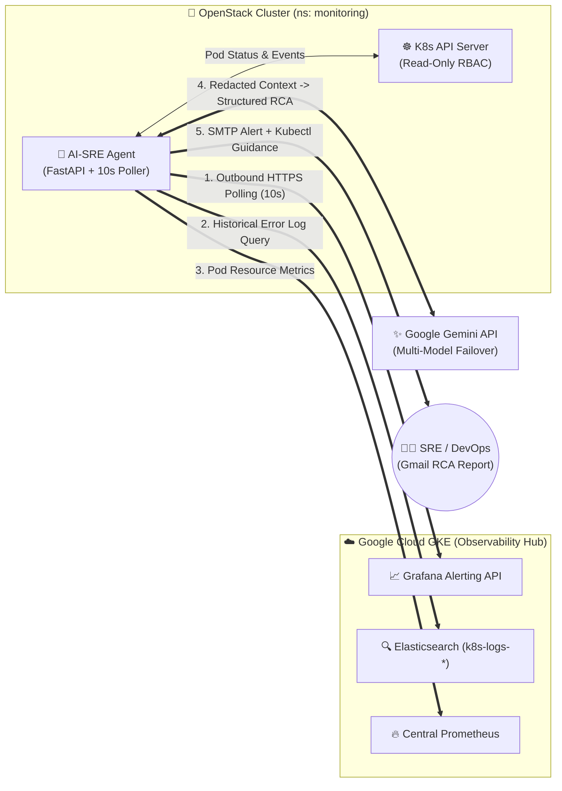

# 🤖 K8S AI-SRE Alert Triage Agent

## 📖 Project Overview
This repository contains the source code, containerization setup, and GitOps CI/CD pipeline for an **Automated AI-SRE Alert Triage Agent** designed for a **Hybrid Multi-Cluster Kubernetes architecture** (OpenStack On-Premise & Google Cloud GKE).

The core objective of this service is to eliminate repetitive manual incident investigation (`kubectl`, Kibana, Grafana) when production alerts fire. Operating under a **Zero-Inbound Exposure** security model, the agent proactively polls firing alerts from GKE, correlates cross-cluster telemetry and Kubernetes events, redacts sensitive PII/secrets, and leverages Google Gemini LLMs to deliver structured Root Cause Analysis (RCA) and safe, Human-in-the-Loop `kubectl` remediation guidance via email.

## 🏗️ System Architecture



**Incident Triage Workflow:**
1. **Zero-Inbound Alert Detection:** A background poller queries the Grafana Alerting API on GKE every 10 seconds over outbound HTTPS, using `fingerprint + startsAt` deduplication to ensure each firing incident triggers LLM analysis exactly once.
2. **Cross-Cluster Context Collection:** Upon detecting an active alert, the agent aggregates live pod statuses and Kubernetes `Events` via in-cluster read-only RBAC alongside historical pre-crash logs from Elasticsearch and CPU metrics from Prometheus.
3. **PII & Secret Sanitization:** Before any diagnostic payload leaves the private cluster boundary, a regex-based sanitizer strips credentials, JWTs, API keys, and database URIs (`[REDACTED]`).
4. **AI Root Cause Analysis & Reporting:** Cleaned diagnostics are evaluated by Google Gemini (with automatic multi-model failover and Pydantic schema validation) to dispatch actionable root-cause reports and manual `kubectl` commands to engineers via SMTP.

## 🛡️ Security, Privacy & Reliability Guardrails

**Design Principles & Safeguards:**
1. **Zero-Inbound Exposure (Outbound Polling):** Eliminates the need to expose OpenStack internal ports or Cloudflare Tunnels to GKE; all cross-cluster communication is initiated outbound from the private tenant.
2. **Defense-in-Depth Runtime Hardening:** Deployed with a namespace-scoped read-only `ClusterRole`/`Role` (`get`, `list` on pods, logs, and events), non-root execution (`UID 1000`), `readOnlyRootFilesystem: true`, and `capabilities.drop: ["ALL"]`.
3. **Pre-Inference Data Redaction:** Enforces strict privacy boundaries by masking sensitive tokens, passwords, and connection strings with `[REDACTED]` prior to external LLM API inference.
4. **Multi-Model Failover & Human-in-the-Loop:** Automatically falls back across Gemini model tiers (`gemini-2.5-flash` $\rightarrow$ `gemini-2.5-flash-lite` $\rightarrow$ `gemini-2.0-flash`) during `429`/`503` spikes, while restricting remediation to advisor-only suggestions to prevent AI hallucinations and GitOps configuration drift.

## 🛠️ Tech Stack
- **Backend & AI Framework:** Python 3.11, FastAPI, Pydantic (Structured JSON Outputs), Google GenAI SDK (`gemini-2.5-flash`).
- **Observability & Data Sources:** Kubernetes Python Client, Grafana Alerting API, Elasticsearch REST API, Prometheus HTTP API.
- **Security & Alerting:** Regex PII/Secret Sanitizer, Kubernetes Read-Only RBAC, Non-Root Container SecurityContext, Python `smtplib` (Gmail SMTP).
- **CI/CD & GitOps Delivery:** Docker (multi-stage/slim build), GitHub Actions (SHA-tagged image builds + automated Pull Request updates to `hybrid-cloud-k8s-manifests`).

## 🚀 Key Technical Implementations
- **Automated Multi-Failure Diagnosis:** Accurately pinpoints `OOMKilled` (exit code 137), `CrashLoopBackOff`, `ImagePullBackOff`, and CPU saturation spikes by correlating container termination states with historical Elasticsearch stack traces.
- **Alert Deduplication & False-Positive Filtering:** Tracks alert fingerprints in memory to prevent duplicate LLM calls and suppresses notifications when diagnostics evaluate to `HEALTHY` (e.g., transient `401 Unauthorized` client noise).
- **Pull-Request Based GitOps CD:** Every commit to `main` builds a SHA-tagged Docker image and automatically opens a reviewable Pull Request in the [`hybrid-cloud-k8s-manifests`](https://github.com/ChauSu36/hybrid-cloud-k8s-manifests) repository rather than force-pushing directly to production manifests.

## ⚙️ Configuration & Environment Variables

| Variable | Source | Description |
| :--- | :--- | :--- |
| `TARGET_NAMESPACE` | ConfigMap | Target workload namespace monitored on OpenStack (default: `jobportal`) |
| `GRAFANA_URL` | ConfigMap | Public HTTPS endpoint of GKE Grafana instance |
| `ELASTICSEARCH_URL` | ConfigMap | Public HTTPS endpoint of GKE Elasticsearch cluster |
| `PROMETHEUS_URL` | ConfigMap | Public HTTPS endpoint of GKE Central Prometheus |
| `POLL_INTERVAL_SECONDS` | ConfigMap | Outbound polling interval in seconds (default: `10`) |
| `GEMINI_API_KEY` | Secret | Google Gemini API key for RCA inference |
| `GRAFANA_API_TOKEN` | Secret | Read-only Viewer service account token for Grafana Alerting API |
| `ELASTICSEARCH_API_KEY` | Secret | Read-only API key scoped to `k8s-logs-*` indices |
| `SMTP_HOST` / `SMTP_PORT` | Secret | Outbound mail server configuration (`smtp.gmail.com` / `587`) |
| `SMTP_USER` / `SMTP_PASS` | Secret | Authenticated sender credentials and Gmail App Password |
| `ALERT_EMAIL_TO` | Secret | Recipient email address for incident RCA reports |

## 📂 Repository Structure

```text
K8S-AI-SRE-AGENT/
├── .github/
│   └── workflows/
│       └── ci-cd.yml           # Builds SHA-tagged Docker image & opens deployment PR in manifest repo
├── agent.py                    # FastAPI entrypoint, 10s outbound poller loop & fingerprint deduplication
├── analyzer.py                 # Gemini API client with multi-model failover & structured prompt logic
├── collector.py                # Cross-cluster context aggregator (K8s API, Elasticsearch, Prometheus)
├── notifier.py                 # Formats & dispatches HTML/text RCA reports via SMTP
├── sanitizer.py                # Regex-based PII, JWT, credential, and database URI redactor
├── schemas.py                  # Pydantic models enforcing structured RCA & remediation output
├── Dockerfile                  # Hardened non-root Python container image definition
├── requirements.txt            # Pinned Python dependencies
├── .gitignore                  # Excludes Python cache, local secrets, and environment files
└── README.md                   # Architecture blueprint, security model, and configuration guide
```